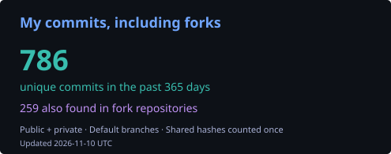

English · [Русский](README.ru.md)

# Andrey Kostin

### AI Agent Developer · MCP · Tool Calling · Backend Integration

I connect LLMs to application data, external APIs, and business workflows. My foundation is **10+ years of JavaScript / TypeScript engineering**, fullstack product delivery, and team leadership.

**Open to AI Agent Developer and LLM Integration roles · Remote**

[Résumé](RESUME.md) · [Email](mailto:losogudok@gmail.com) · [Telegram](https://t.me/gordonfreemanvpn)

---

### What I bring

- **Agents that can use real systems.** MCP servers, function calling, JSON Schema tool definitions, and integrations with APIs and databases.
- **Engineering around the model.** Clear tool boundaries, structured results, partial-failure handling, tests, and production diagnostics.
- **Product ownership.** Turning a business problem into requirements, an MVP, priorities, releases, and ongoing support.
- **Commercial experience behind the AI work.** Previously at Yandex, Lamoda, and Kaspersky Lab; built fintech products, led a JavaScript team, and taught JavaScript at Netology.

My applied AI work is in personal and project-based development since 2025. My longer commercial background is in web and backend engineering.

### Selected work

#### [MCP diagnostics for a trading bot](projects/trading-diagnostics.md)

**Python · FastMCP · PostgreSQL · OKX API**

Built a read-only MCP server that brings exchange and database state into one structured diagnostic snapshot. It reports source availability and explainable discrepancies, with unit tests for diagnostic rules. The diagnostics tools cannot place or cancel orders.

Personal project; implementation is private. **[Read the engineering case study →](projects/trading-diagnostics.md)**

#### [GlampBot — a booking assistant](projects/glampbot.md)

**TypeScript · Node.js · OpenAI SDK · LiteLLM · grammY · Prisma**

A Telegram assistant prototype that checks accommodation availability, retrieves property information, and creates booking drafts through application tools. Tool parameters use JSON Schema, and the application supplies the Telegram user identity.

Prototype. **[See the tool-calling flow →](projects/glampbot.md)**

#### [Agent-assisted delivery in Lush Guesser](https://github.com/losogudok/lush-guesser/tree/main/.sandcastle)

**TypeScript · Sandcastle · Docker · React · NestJS · Playwright**

A public planning → implementation → review → merge workflow for GitHub issues, using Docker sandboxes and structured plan validation. The host application is a scent quiz with a React frontend, NestJS backend, and browser tests.

**[Workflow source →](https://github.com/losogudok/lush-guesser/blob/main/.sandcastle/main.mts)** · **[Application →](https://github.com/losogudok/lush-guesser)** · **[Browser tests →](https://github.com/losogudok/lush-guesser/tree/main/tests/e2e)**

### Engineering beyond AI

I also maintain customized forks for the FreemanVPN ecosystem: [routing templates](https://github.com/losogudok/freemanvpn-routing), [GeoSite](https://github.com/losogudok/freemanvpn-geosite), [GeoIP](https://github.com/losogudok/freemanvpn-geoip), and a [Remnawave subscription storefront](https://github.com/losogudok/remnawave-minishop). These projects cover client compatibility, networking, automation, and service operations.

### Stack

| Area | Tools |
| --- | --- |
| AI integrations | MCP / FastMCP, LLM APIs, function calling, JSON Schema, OpenAI SDK |
| Backend & data | TypeScript, Node.js, Python, NestJS, Express, PostgreSQL, Redis, MongoDB |
| Product interfaces | React, REST / GraphQL APIs, Telegram bots and Mini Apps |
| Delivery & quality | Docker, Linux, GitHub Actions, unit tests, Playwright, code review |

### GitHub Stats

Unique commits authored by me in the past 365 days, including forks and private repositories accessible to the stats token. Counts use commit dates and default branches; shared commit hashes count once. Updated daily. GitHub's contribution calendar uses different rules.

---

**Hiring for agents, MCP tooling, or LLM integrations?** [Email me](mailto:losogudok@gmail.com) with the role and the problem your team is solving.
