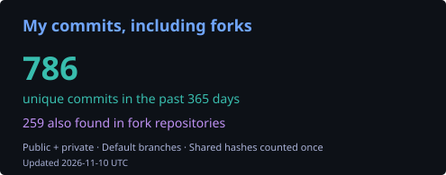

[English](README.md) · Русский

# Андрей Костин

### AI Agent Developer · MCP · Tool Calling · Backend-интеграции

Подключаю LLM к данным приложений, внешним API и бизнес-процессам. В основе — **более 10 лет разработки на JavaScript / TypeScript**, запуск fullstack-продуктов и руководство командой.

**Рассматриваю позиции AI Agent Developer и разработчика LLM-интеграций · Удалённо**

[Резюме](RESUME.ru.md) · [Email](mailto:losogudok@gmail.com) · [Telegram](https://t.me/gordonfreemanvpn)

---

### Что я привношу в команду

- **Агенты, работающие с реальными системами.** MCP-серверы, function calling, описания инструментов через JSON Schema, интеграции с API и базами данных.
- **Инженерная часть вокруг модели.** Границы полномочий инструментов, структурированные результаты, обработка частичных отказов, тесты и диагностика.
- **Навыки Product Owner.** Перевод бизнес-задачи в требования, MVP, приоритеты, релизы и дальнейшее сопровождение.
- **Коммерческий опыт за AI-проектами.** Работал в Яндексе, Lamoda и Лаборатории Касперского; разрабатывал fintech-продукты, руководил JavaScript-командой и преподавал в Нетологии.

Прикладной AI — собственные и проектные разработки с 2025 года. Многолетний коммерческий опыт — web и backend.

### Избранные проекты

#### [MCP-диагностика торгового бота](projects/trading-diagnostics.md)

**Python · FastMCP · PostgreSQL · OKX API**

Создал MCP-сервер, который объединяет данные биржи и базы в структурированный диагностический снимок. Инструменты работают только на чтение, показывают доступность источников и объяснимые расхождения. Диагностические правила покрыты unit-тестами; инструменты не размещают и не отменяют ордера.

Собственный проект, закрытая реализация. **[Инженерный разбор →](projects/trading-diagnostics.md)**

#### [GlampBot — ассистент бронирования](projects/glampbot.md)

**TypeScript · Node.js · OpenAI SDK · LiteLLM · grammY · Prisma**

Прототип Telegram-ассистента: проверка свободных домиков, справочная информация и создание черновика бронирования через инструменты приложения. Параметры описаны через JSON Schema, а Telegram userId передаётся на стороне приложения.

Прототип. **[Сценарий tool calling →](projects/glampbot.md)**

#### [Разработка с AI-агентами в Lush Guesser](https://github.com/losogudok/lush-guesser/tree/main/.sandcastle)

**TypeScript · Sandcastle · Docker · React · NestJS · Playwright**

Открытый workflow для GitHub Issues: планирование → реализация → ревью → слияние. Использует Docker-песочницы и проверку структуры плана. Само приложение — игра на угадывание ароматов с React-интерфейсом, NestJS backend и браузерными тестами.

**[Код workflow →](https://github.com/losogudok/lush-guesser/blob/main/.sandcastle/main.mts)** · **[Приложение →](https://github.com/losogudok/lush-guesser)** · **[Браузерные тесты →](https://github.com/losogudok/lush-guesser/tree/main/tests/e2e)**

### Инженерная работа за пределами AI

Поддерживаю собственные доработки форков для FreemanVPN: [шаблоны маршрутизации](https://github.com/losogudok/freemanvpn-routing), [GeoSite](https://github.com/losogudok/freemanvpn-geosite), [GeoIP](https://github.com/losogudok/freemanvpn-geoip) и [магазин подписок Remnawave](https://github.com/losogudok/remnawave-minishop). Это работа с совместимостью клиентов, сетями, автоматизацией и эксплуатацией сервисов.

### Стек

| Направление | Инструменты |
| --- | --- |
| AI-интеграции | MCP / FastMCP, LLM API, function calling, JSON Schema, OpenAI SDK |
| Backend и данные | TypeScript, Node.js, Python, NestJS, Express, PostgreSQL, Redis, MongoDB |
| Интерфейсы | React, REST / GraphQL API, Telegram-боты и Mini Apps |
| Поставка и качество | Docker, Linux, GitHub Actions, unit-тесты, Playwright, code review |

### Текущая инженерная активность

Обновляется ежедневно. Мои уникальные коммиты за последние 365 дней, включая доступные приватные репозитории и форки. Учитываются даты коммитов и основные ветки; одинаковые хеши считаются один раз. Календарь активности GitHub использует другие правила.

---

**Ищете разработчика агентов, MCP-инструментов или LLM-интеграций?** [Напишите мне](mailto:losogudok@gmail.com) о позиции и задаче вашей команды.
